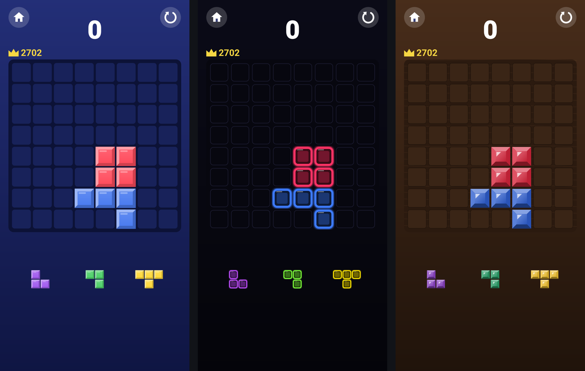
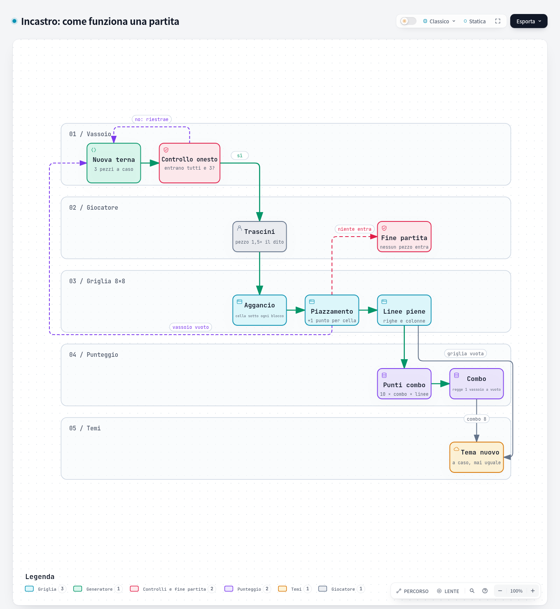
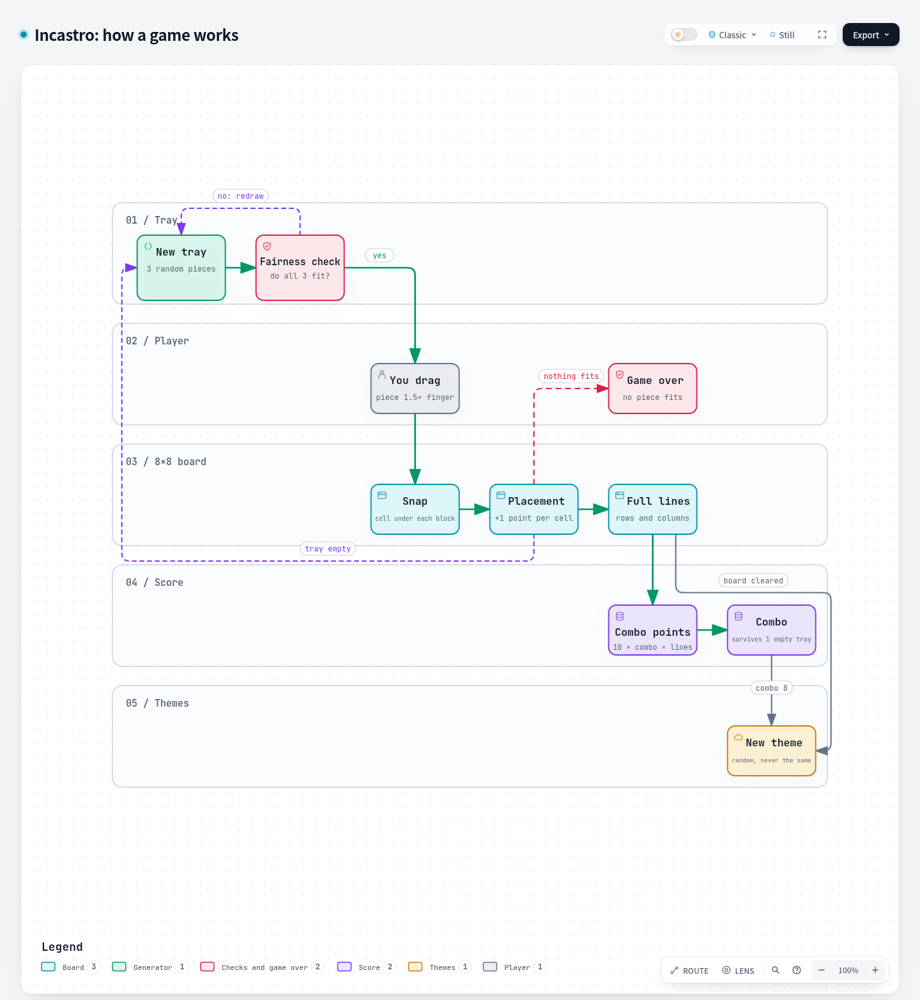

# Incastro

**🇮🇹 Italiano** · [🇬🇧 English](#english)

Puzzle a blocchi 8×8 per Android, **gratuito e open source**. Niente pubblicità, niente acquisti, niente raccolta dati e nessuna difficoltà manipolata: se perdi, è solo per come hai giocato.



## Cos'è

Trascini sulla griglia i 3 pezzi del vassoio. Quando una riga o una colonna si riempie, sparisce e fa punti. Quando nessun pezzo entra più, la partita finisce.

## Cosa lo rende diverso

Molti giochi di questo tipo sono gratuiti perché vivono di pubblicità, e a volte regolano la difficoltà dietro le quinte per farti ricominciare più spesso. Incastro no:

- **Pezzi onesti**: ogni terna è estratta a caso e viene accettata solo se si può piazzare per intero. Il gioco non sceglie mai pezzi "per farti perdere" e non cambia la difficoltà in base a quanto giochi, al tuo record o ad altro.
- **Zero pubblicità, zero acquisti**: nessun video da guardare per continuare, niente monete, niente abbonamenti.
- **Zero dati**: l'app non chiede nemmeno il permesso di accedere a Internet. Record e partita restano sul telefono.
- **Open source** (GPL-3.0): il codice è tutto qui, chiunque può controllarlo.

## Regole

- **Griglia 8×8**, 3 pezzi per volta scelti a caso tra 29 forme (più il blocco singolo, solo come ultima risorsa quando nessuna terna può entrare). Il vassoio si ricarica quando li hai usati tutti.
- **Punti**:
  - 1 punto per ogni cella piazzata;
  - 1 linea: 10 × combo;
  - più linee insieme: 10 × combo × n × (n−1), quindi 2 linee 20, 3 linee 60, 4 linee 120 (per combo 1);
  - griglia svuotata: +300 dal 6° vassoio in poi.
- **Combo**: sale di 1 a ogni mossa che fa linee e si azzera solo se piazzi un vassoio intero senza farne. I pezzi che ti restano nel vassoio quando fai una linea non contano.
- **Trascinamento**: al tocco il pezzo si solleva sopra il dito, così lo vedi sempre, e si muove 1,5 volte più veloce del dito. Si aggancia alla cella che sta sotto ogni blocco.

## Temi

Tre temi: **Classico**, **Neon** e **Legno e pietra**. Cambiano a caso, mai uguali al precedente, quando svuoti la griglia (dal 6° vassoio) o raggiungi una combo 8, 16 e così via.

## Lingue

Italiano e inglese. Al primo avvio segue la lingua del telefono; poi si cambia da **Impostazioni → Lingua**.

## Installazione

Scarica l'APK dalla pagina [Releases](https://github.com/Macchp3840/incastro/releases) e aprilo sul telefono (Android 8.0 o superiore). Android chiede di permettere l'installazione da quella app: è normale per le app scaricate fuori dal Play Store.

## Come funziona una partita



Versione interattiva: **[mappa (italiano)](https://macchp3840.github.io/incastro/mappa.html)** · [map (English)](https://macchp3840.github.io/incastro/map.html)

*Mappa creata con la skill [Archify](https://github.com/tt-a1i/archify).*

## Compilare dal codice

Serve solo l'Android SDK (platform 36 e build-tools 36.0.0 in `~/Android/Sdk`, oppure in `ANDROID_HOME`) e un JDK 17 o più recente. Niente Gradle:

```bash
./build.sh          # test del motore + APK in build/Incastro.apk
./build.sh test     # solo i test del motore
```

Senza altre indicazioni l'APK viene firmato con una chiave di prova generata sul momento. Per firmarlo con una tua chiave: `SIGNING_KEYSTORE=… SIGNING_KEY_ALIAS=… SIGNING_PASSWORD=… ./build.sh`.

## Licenza

[GPL-3.0](LICENSE): puoi usarlo, studiarlo, modificarlo e ridistribuirlo, ma le versioni modificate devono restare open source con la stessa licenza.

Incastro è un progetto indipendente e non è affiliato ad altri giochi né ad altre aziende.

---

<a id="english"></a>

# Incastro

[🇮🇹 Italiano](#incastro) · **🇬🇧 English**

An 8×8 block puzzle for Android, **free and open source**. No ads, no purchases, no data collection and no manipulated difficulty: if you lose, it's only down to how you played.


## What it is

Drag the 3 pieces from the tray onto the board. When a row or column is full, it clears and scores. When no piece fits anymore, the game is over.

## What makes it different

Many games of this kind are free because they live on ads, and sometimes they tune the difficulty behind the scenes so you start over more often. Incastro doesn't:

- **Fair pieces**: every tray is drawn at random and only accepted if all of it can be placed. The game never picks pieces "to make you lose" and never changes the difficulty based on how much you play, your best score or anything else.
- **No ads, no purchases**: no videos to watch to keep going, no coins, no subscriptions.
- **No data**: the app doesn't even ask for Internet access. Your best score and your game stay on your phone.
- **Open source** (GPL-3.0): all the code is here for anyone to check.

## Rules

- **8×8 board**, 3 pieces at a time drawn at random from 29 shapes (plus the single block, only as a last resort when no tray can fit). The tray refills once you've used them all.
- **Points**:
  - 1 point per placed cell;
  - 1 line: 10 × combo;
  - several lines at once: 10 × combo × n × (n−1), so 2 lines 20, 3 lines 60, 4 lines 120 (at combo 1);
  - board cleared: +300 from the 6th tray on.
- **Combo**: goes up by 1 with every move that clears lines, and only resets if you place a whole tray without clearing any. The pieces still in your tray when you clear a line don't count.
- **Dragging**: when you touch a piece it lifts above your finger, so you can always see it, and moves 1.5 times faster than your finger. It snaps to the cell under each block.

## Themes

Three themes: **Classic**, **Neon** and **Wood & stone**. They switch at random, never repeating the current one, when you clear the board (from the 6th tray) or reach combo 8, 16 and so on.

## Languages

Italian and English. On first launch it follows your phone's language; you can change it in **Settings → Language**.

## Install

Download the APK from the [Releases](https://github.com/Macchp3840/incastro/releases) page and open it on your phone (Android 8.0 or later). Android will ask you to allow installs from that app: that's normal for apps downloaded outside the Play Store.

## How a game works



Interactive version: **[map (English)](https://macchp3840.github.io/incastro/map.html)** · [mappa (italiano)](https://macchp3840.github.io/incastro/mappa.html)

*Map made with the [Archify](https://github.com/tt-a1i/archify) skill.*

## Build from source

You only need the Android SDK (platform 36 and build-tools 36.0.0 in `~/Android/Sdk`, or in `ANDROID_HOME`) and JDK 17 or newer. No Gradle:

```bash
./build.sh          # engine tests + APK in build/Incastro.apk
./build.sh test     # engine tests only
```

By default the APK is signed with a test key generated on the fly. To sign it with your own key: `SIGNING_KEYSTORE=… SIGNING_KEY_ALIAS=… SIGNING_PASSWORD=… ./build.sh`.

## License

[GPL-3.0](LICENSE): you can use, study, modify and redistribute it, but modified versions must stay open source under the same license.

Incastro is an independent project and is not affiliated with any other game or company.

---

Macchp3840
